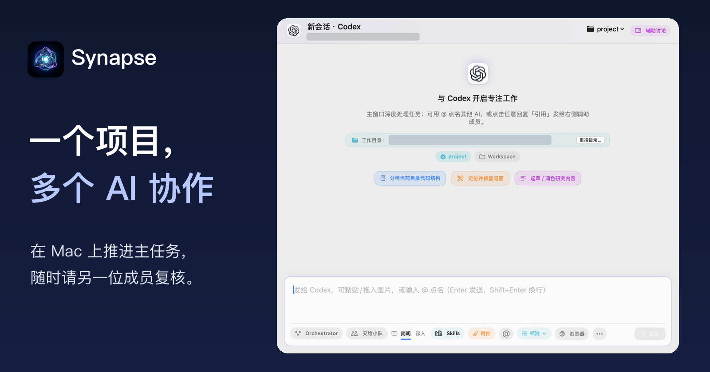
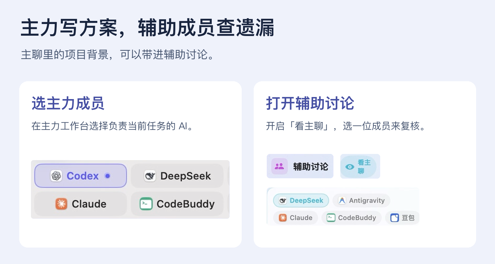
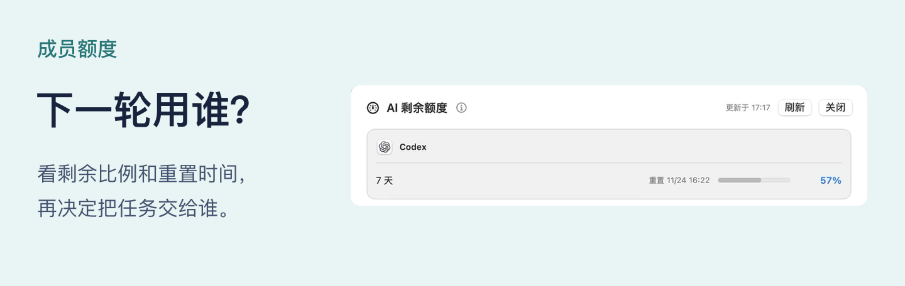
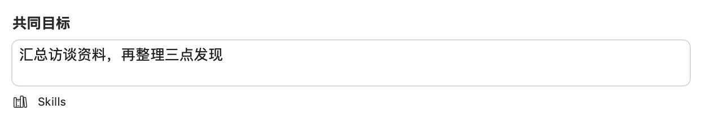
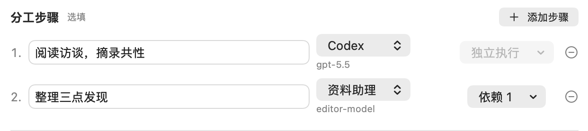

# Synapse · macOS 多 AI 协作台

把 Codex、DeepSeek 和 Antigravity 放进同一个项目窗口。你可以让一个 AI 持续推进主任务，再把需要复核的部分交给另一个 AI 讨论。项目目录、主对话和辅助讨论都有各自的位置，回来时可以接着上次的进度工作。

**[下载最新版](https://github.com/Houshenglab/Synapse-releases/releases/latest)　·　[产品官网](https://test.mibhr.cn/synapse/)　·　[反馈问题](https://github.com/Houshenglab/Synapse-releases/issues)**

点封面可查看工作台原图。图中使用本地演示项目，目录已遮盖。不同版本的工具栏会略有差异。

## 从主任务到辅助讨论

例如，用 Codex 起草活动方案后，可以打开「辅助讨论」，让 DeepSeek 参考主聊，检查方案是否写清了时间、地点和报名方式。

额度面板显示成员服务提供的数据。图中的百分比和时间是录制时的示例。

## 用小队整理一批访谈

下面是 Synapse 小队面板的实际控件，使用演示项目和示例成员。

### Skill · 复用一份工作方法

把常用要求写进 SKILL.md，加入技能库。下次整理访谈时，在「项目小队」的 Skills 入口选中它，就可以把同一套要求交给参与任务的成员。

例如，要求每条发现都附一段受访者原话，并标明访谈编号。下一批访谈也能沿用这个标准。

### 项目小队 · 给每一步指定负责人

打开「项目小队」，写下共同目标。你可以预设每一步由谁做、要等哪一步，也可以只写目标，让小队拆分步骤。

图中，Codex 先摘录访谈中的共性。资料助理的步骤设为「依赖 1」，等摘录完成后再整理三点发现。用「交给小队」发送任务后，可在主聊查看分工、各步结果和最后的汇总。

### Orchestrator · 按步骤选模型

在主聊输入框旁或小队面板底部打开「Orchestrator 自动选模」。执行每一步时，Synapse 会结合输入材料和要交付的结果，从可用模型里筛选。关闭开关时，各成员使用当前选定的模型。

例如，你可以指定由资料助理写总结，同时让 Orchestrator 为这一步选择能处理文字的模型。

## 可以用它做什么

| 你想做的事 | 在 Synapse 里怎么用 |
| --- | --- |
| 让另一个 AI 帮忙复核 | 在主力工作台继续原对话，打开辅助讨论，让另一位成员参考主聊上下文。适合一边写方案，一边核对假设。 |
| 让多位成员讨论同一份材料 | 在项目群聊中用 @ 点名成员，把问题和文件放在同一处，方便对照不同成员的回答。 |
| 保留不同尝试 | 按项目管理会话，从已有回复创建分支，单独尝试另一种解法，方便回到原来的讨论。 |
| 重复使用自己的工作方法 | 把本机的 SKILL.md 加入技能库，发送消息时选中所需说明，让不同成员按同一套要求工作。 |
| 找回长任务的结果 | 从任务记录回到对应会话。长对话按页读取并在本机缓存，临时读取超时时保留已经显示的内容。 |
| 安排接下来用哪个模型 | 在额度面板查看成员能够提供的剩余额度与重置时间。有足够的历史数据时，还能参考消耗趋势估算。 |

## 第一次使用

1. 准备一台 **Apple 芯片 Mac，macOS 13 或更高版本**。从 Releases 下载文件名以 `Synapse-v` 开头的 ZIP，解压后将 `Synapse.app` 拖入「应用程序」。当前发行包未经过 Apple 公证，首次打开时 macOS 可能提示验证开发者。
2. 打开 Synapse，按应用内提示登录并完成授权。各 AI 成员使用各自的账号、客户端和服务额度。先连接一个你已经在使用的成员即可开始。
3. 选择项目目录，新建会话，发送第一个任务。例如，让主力成员整理一份需求，然后请辅助成员检查遗漏的边界条件。

## 版本与反馈

每个 Release 都附有版本说明。下载应用请选择发布附件里的安装包；GitHub 自动生成的 Source code 压缩包只包含发行仓库的说明文件。

反馈时请附上 Synapse 版本、macOS 版本、所用 AI 成员和触发问题的步骤。截图前请遮住账号信息、密钥和私人对话。
